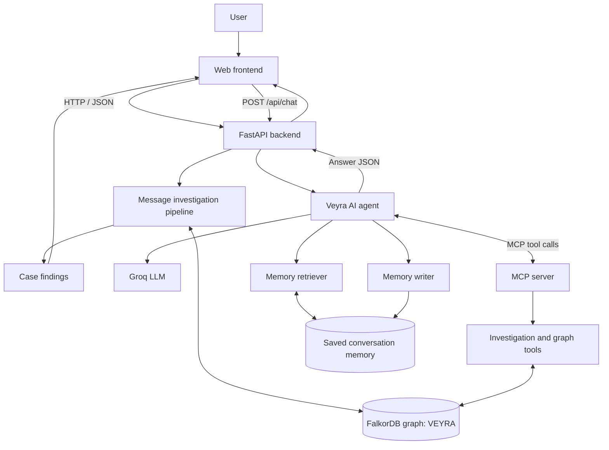
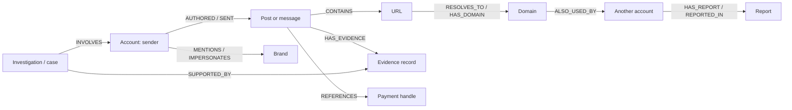
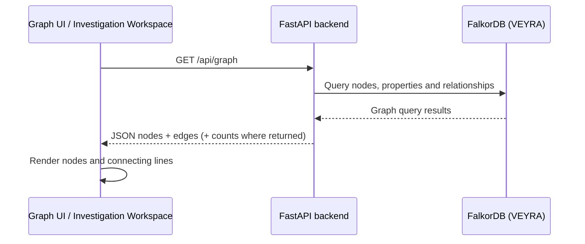

# Veyra — Connected Evidence Intelligence

> Investigate suspicious messages. Follow connected evidence. Revisit cases without losing context.

Veyra is a graph-powered investigation demo that helps analysts examine messages and account activity by connecting accounts, URLs, domains, brands, payment identifiers, reports, and supporting evidence. It combines a web interface, a Python API, an AI agent, MCP tools, and FalkorDB graph queries.

**Demo safety:** use the synthetic scenarios and records provided for testing. A graph connection or shared attribute is an investigative lead—not proof of wrongdoing. Verify evidence before making real-world decisions.

## Contents

- [Highlights](#highlights)
- [Screens and usage](#screens-and-usage)
- [How the project connects](#how-the-project-connects)
- [Investigation lifecycle](#investigation-lifecycle)
- [Technology stack](#technology-stack)
- [Repository layout](#repository-layout)
- [Prerequisites and configuration](#prerequisites-and-configuration)
- [Run with Docker Compose](#run-with-docker-compose)
- [Run locally](#run-locally)
- [API overview](#api-overview)
- [Persistent memory and history](#persistent-memory-and-history)
- [FalkorDB graph model](#falkordb-graph-model)
- [Troubleshooting](#troubleshooting)
- [Security and responsible use](#security-and-responsible-use)

## Highlights

- Submit a message and create an investigation case.
- Explore connected graph evidence and multi-hop relationships.
- Ask the Veyra agent natural-language questions about an investigation.
- Use MCP tools to retrieve structured information for the agent.
- Reopen saved cases and review recorded findings.
- Retrieve relevant prior conversation context and persist new turns.
- Explain uncertainty instead of treating a graph connection as proof.

## Screens and usage

The precise controls can vary by branch/build. These sections describe the main screens and their intended workflow.

### 1. Landing / Home

**Purpose:** introduce Veyra and provide an entry point to the investigation flow.

1. Open the application in your browser.
2. Review the overview and connected-evidence concept.
3. Select **Start Investigation** or the message-analysis action.
4. Use the navigation to return home or visit other sections.

Navigation alone should not create a case unless the UI submits a message.

### 2. DMs / Message Simulator

**Purpose:** inspect a sample direct message and choose whether to investigate it.

1. Open **DMs** from the navigation.
2. Select a synthetic message supported by the demo.
3. Review the sender and message content.
4. Start the investigation and wait for the result/status.
5. Open the resulting case to inspect the findings.

The current standalone UI uses `POST /api/messages/analyze` to submit a message. The backend creates a case and runs the investigation pipeline against connected evidence in FalkorDB.

### 3. Investigation Workspace / Case Details

**Purpose:** review one investigation in context. Depending on the build, it can show a summary/assessment, indicators, evidence, connected entities, graph traversal details, a graph view, and an assistant chat.

1. Open a case from a new investigation or the Cases list.
2. Read the summary, then inspect the supporting evidence.
3. Expand traversal details to understand how entities are connected.
4. Explore graph nodes and relationships where available.
5. Ask a follow-up question in the chat, keeping the same session/case context when appropriate.
6. Reopen the case later to review its saved results.

A shared domain, repeated wording, common payment identifier, or connection can justify further review; it does not automatically prove common ownership or malicious intent.

### 4. Cases / Investigation History

**Purpose:** find previously created investigations and reopen their details.

1. Open **Cases** or the archive.
2. Browse saved case identifiers, timestamps, and statuses.
3. Select a case to inspect its stored results.
4. Review the recorded summary and findings against the evidence available.
5. Continue in the case chat/history view if that control is present.

Case records, graph data, and conversation memory are separate but related stores. A saved case does not necessarily mean every chat message is embedded in the case record itself.

### 5. Graph Explorer / Investigation Graph

**Purpose:** see connected data as nodes and edges rather than only as prose.

1. Open the graph section.
2. Wait for nodes and relationships to load.
3. Follow edges between accounts, URLs/domains, brands, payment identifiers, reports, and evidence where present.
4. Use the graph alongside the case findings to understand why a connection matters.

The frontend requests graph data through the backend, including `GET /api/graph`. The backend queries the `VEYRA` graph in FalkorDB. The UI may render a bounded subset for responsiveness while the API calculates database-wide totals separately.

### 6. Agent Chat

**Purpose:** ask questions about the current investigation in natural language.

Example questions:

- “Why was this case classified as high risk?”
- “Which domains are connected to this account?”
- “What evidence supports this finding?”
- “Have we discussed this case before?”
- “What is still uncertain?”

Open chat, ask a focused question, check the answer against the evidence, and follow up if needed. The `/api/chat` endpoint calls the Veyra agent. The agent can retrieve saved conversation context, use Groq for language generation, and call MCP tools for structured investigation data. If evidence is unavailable, the agent should say so rather than invent it.

### 7. FalkorDB Browser / Database UI

**Purpose:** inspect graph records directly during development. If the Compose file maps the FalkorDB browser to port `3000`, try `http://localhost:3000`; confirm the actual mapping in `compose.yaml` if it does not open. The backend graph name is `VEYRA`.

Use the database UI to validate nodes, relationships, and queries. Avoid destructive queries against your working graph.

## How the project connects



| Component | Responsibility |
|---|---|
| Web frontend | Renders screens, captures actions, and displays cases, graph data, and chat answers. |
| `backend/main.py` | FastAPI routes, request validation, and orchestration. |
| `backend/agent/message_pipeline.py` | Creates case records and runs message investigation logic. |
| Investigator / graph traversal | Queries and evaluates connected graph evidence. |
| FalkorDB | Stores graph entities and relationships used as investigative evidence. |
| `backend/agent/groq_agent.py` | Orchestrates the LLM response, memory retrieval, and MCP tool use. |
| Groq | Provides the language model used to interpret questions and formulate answers. |
| `backend/mcp_server.py` | Exposes structured tools through Model Context Protocol. |
| Memory retriever/writer | Retrieves relevant prior conversation context and persists new turns. |

### Keep these concepts distinct

- **FalkorDB is the evidence graph:** entities and links used to investigate relationships.
- **Case history is the investigation record:** lets a user reopen cases and review stored findings.
- **Conversation memory is continuity context:** helps the agent recall relevant prior exchanges.
- **Groq is the language model:** generates responses from prompts and retrieved information.
- **MCP is the tool protocol:** lets the agent request structured operations from the MCP server.

A remembered statement is not verified evidence. A previous AI answer is not independent corroboration. Current evidence should be retrieved when answering questions about current graph state.

## Investigation lifecycle

1. The user selects a message and starts an investigation.
2. The frontend sends the message to FastAPI.
3. The backend creates a case and runs the message investigation pipeline.
4. Investigation logic queries FalkorDB for connected entities and relationships.
5. The backend returns case findings and the frontend displays them.
6. A follow-up chat question reaches `/api/chat`.
7. The agent retrieves relevant conversation context and can call MCP tools.
8. Groq generates a response using the available context/tool results.
9. The response is returned to the UI and conversation turns are saved through the memory writer.
10. The user can revisit the case and its available history later.

## Technology stack

- **Frontend:** TypeScript, React, Vite, CSS/HTML; the repository also contains a standalone `frontend/index.html` interface.
- **Backend:** Python and FastAPI.
- **AI:** Groq API via the Python Groq client.
- **Tool integration:** Model Context Protocol (MCP).
- **Graph database:** FalkorDB.
- **Runtime:** Docker and Docker Compose, plus local Python/Node development options.

The repository contains both a standalone HTML interface and React components. When debugging a screen, confirm which entry point serves the URL you are actually opening.

## Repository layout

```text
Veyra-demo/
├── backend/
│   ├── main.py                    # FastAPI routes
│   ├── mcp_server.py              # MCP server
│   ├── agent/
│   │   ├── groq_agent.py          # Agent, LLM orchestration and chat
│   │   ├── message_pipeline.py    # Case creation and investigation pipeline
│   │   ├── investigator.py        # Scenario investigation logic
│   │   ├── graph_traversal.py     # Graph traversal helpers
│   │   ├── memory_retriever.py    # Retrieve saved conversation context
│   │   └── memory_writer.py       # Persist conversation turns
│   └── graph/
│       └── connection.py          # FalkorDB connection / graph name
├── frontend/
│   ├── index.html                 # Standalone UI / message simulator
│   └── src/
│       ├── App.tsx                # React application shell and views
│       ├── InvestigationWorkspace.tsx
│       ├── workspace-entry.tsx    # Workspace entry / bridge
│       ├── GraphExplorer.tsx
│       └── Landing.tsx
├── compose.yaml                   # Primary Compose configuration
├── docker-compose.yml             # Alternate/legacy file may exist
└── README.md
```

File availability can vary by branch; the checked-out files are the source of truth.

## Prerequisites and configuration

You need Git and Docker Desktop with Compose, or Python 3.11+ and Node.js/npm for local development. AI chat requires a Groq API key.

Create a root `.env` if needed. Never commit real credentials:

```dotenv
GROQ_API_KEY=replace_with_your_own_key
GROQ_MODEL=openai/gpt-oss-120b

# Optional override only if required by your runtime:
# VEYRA_MCP_PYTHON=/absolute/path/to/python
```

Check `compose.yaml` and `backend/graph/connection.py` for the exact FalkorDB host/port settings used by your runtime. If `.env.example` is missing, create one with placeholders only—never copy the real `.env` into Git.

## Run with Docker Compose

From the repository root:

```bash
docker compose -f compose.yaml up -d --build
docker compose -f compose.yaml ps
```

This repository has also contained a `docker-compose.yml`; use `-f compose.yaml` to select the intended file explicitly. Check the actual service names and port mappings with `docker compose -f compose.yaml ps` and the Compose file.

Common development URLs have included:

- Frontend container: `http://localhost:8080`
- Vite development server: `http://localhost:5173` (when running)
- FastAPI docs: `http://localhost:8000/docs`
- Health endpoint: `http://localhost:8000/api/health`
- FalkorDB browser/UI: `http://localhost:3000` if mapped

Use the mappings in your Compose file as the source of truth. Useful commands:

```bash
docker compose -f compose.yaml logs -f
docker compose -f compose.yaml ps
```

For service-specific logs, use the exact service name shown by `ps`.

**Preserve your data:** do not run `docker compose down -v`, remove database volumes, or delete graph/dump files just to rebuild the app. A normal rebuild should not require deleting persistent data.

## Run locally

Keep FalkorDB running with the project's Compose configuration and run the backend/frontend in separate terminals.

### 1. Start FalkorDB

```bash
docker compose -f compose.yaml up -d falkordb
docker compose -f compose.yaml ps
```

If the service has a different name, use the service listed by `docker compose -f compose.yaml config --services`.

### 2. Set up Python

From the repository root:

```bash
python3 -m venv .venv
source .venv/bin/activate
python -m pip install --upgrade pip
```

Install dependencies from the requirements file that exists in your checkout, for example:

```bash
pip install -r requirements.txt
```

If the repository uses a backend-specific requirements file, install that file instead. Check the project files rather than guessing.

### 3. Start the backend

Make sure `.env` is configured, then run:

```bash
python -m uvicorn backend.main:app --host 0.0.0.0 --port 8000 --reload
```

If port `8000` is already in use, inspect the running process/container and reuse it rather than starting a duplicate server.

### 4. Start the frontend

In a second terminal:

```bash
cd frontend
npm install
npm run dev
```

Open the URL printed by Vite (often `http://localhost:5173`). The standalone `frontend/index.html` served by Compose may be a separate entry point; confirm which UI contains the screen you want to test.

## API overview

Verify the live schema at `http://localhost:8000/docs`. The principal endpoints used by the current project include:

| Method | Endpoint | Purpose |
|---|---|---|
| `GET` | `/` | Basic API welcome response. |
| `GET` | `/api/health` | Check backend-to-FalkorDB connectivity and graph name. |
| `GET` | `/api/graph` | Return graph nodes and relationships for visualization. |
| `GET` | `/api/scenarios` | List investigation scenarios. |
| `GET` | `/api/scenarios/{scenario_id}` | Scenario-specific retrieval/investigation, depending on the current route implementation. |
| `POST` | `/api/messages/analyze` | Submit a message and create/run a case. |
| `POST` | `/api/chat` | Ask the Veyra agent a question. |
| `GET` | `/api/cases` | List saved cases. |
| `GET` | `/api/cases/{case_id}` | Retrieve a saved case. |

Example health check:

```bash
curl -i http://localhost:8000/api/health
```

Example chat request:

```bash
curl -i --max-time 45 -X POST http://localhost:8000/api/chat \
  -H 'Content-Type: application/json' \
  -d '{"question":"What evidence is connected to this case?","session_id":"demo-case-session"}'
```

Keep the same `session_id` for a conversation whose prior turns should be retrieved. Use a new ID for a separate session.

## Persistent memory and history

Veyra's continuity design has three related layers:

1. **Graph data in FalkorDB:** entities and relationships used as investigative evidence.
2. **Case records:** identifiers, status, message metadata, and investigation results used to reopen a case.
3. **Conversation memory:** the agent's memory retriever and writer save and retrieve conversation context associated with session identifiers.

When a follow-up reaches `ask_veyra(...)`, the agent can retrieve recent messages for the session and search relevant saved memories before answering. It can call MCP tools for structured, current evidence. The memory system only recalls information that was successfully saved and retrieved; it should not pretend to remember missing information. A saved AI answer is conversation history, not independent evidence.

## FalkorDB graph model: how the data is linked

Veyra models an investigation as a **connected evidence graph**, rather than treating each message or account as an isolated row. A node represents an entity or record; an edge represents a recorded relationship between two nodes. FalkorDB stores that graph under the `VEYRA` graph name configured by the backend.

### Main node types

| Node | What it represents | Example of useful properties |
|---|---|---|
| `Account` | A platform-neutral social/account profile | account ID, display name, platform, follower count, profile metadata |
| `Post` / message | Content published or sent by an account | text, timestamp, source/message ID |
| `URL` | A link included in content | URL string, normalized URL |
| `Domain` | The host/domain associated with a URL | hostname, normalized domain |
| `Brand` | A brand mentioned or impersonated in the synthetic scenario | brand name, official-domain reference |
| `PaymentIdentifier` / `PaymentHandle` | A payment destination referenced in content | handle/type/value as represented in the synthetic data |
| `Report` | A report record related to an account or item | report ID, status, timestamp, reporter metadata when available |
| `Evidence` | A recorded observation that supports review | evidence ID, type, source/provenance, timestamp |
| `Scenario` / `Investigation` | A test scenario or saved investigation record, when implemented in the active dataset | scenario/case ID, status, created/updated timestamps |

Exact labels and property names can differ by dataset version. The current seed data and query implementation are the source of truth; the table describes the graph concepts, not a guarantee that every node has every property.

### Example relationship map



> The diagram illustrates the **kind of linkage Veyra investigates**. Relationship names above are descriptive examples; use the actual relationship types stored by your current seed/query code when validating a particular edge.

### How one investigation follows the links

Consider a synthetic message that contains a checkout link:

1. **Start at the sender account.** Veyra identifies the account associated with the message, when that association is available in the input/data.
2. **Inspect the message or post.** The content can contain a URL, brand reference, payment handle, or other indicators.
3. **Follow the URL to its domain.** URL and domain nodes allow the system to reason about shared infrastructure rather than comparing only message text.
4. **Find other accounts connected to that domain.** This is a multi-hop graph traversal; the result is a lead to examine, not proof of shared ownership.
5. **Check reports and evidence.** Veyra looks for report/evidence records linked to the relevant entities and considers their provenance and status when those fields are available.
6. **Build an explainable result.** The case view can present findings and the graph path so a reviewer can see which observed connections contributed to the assessment.

A simplified path is:

`Account → Message/Post → URL → Domain → Other Account → Report/Evidence`

A different scenario may use a shorter or longer path. Missing edges should be treated as missing evidence—not filled in by assumption.

### Live graph view: how the map is connected to the database

The graph on screen is a **visual map of graph data**, not a separate source of truth. The expected data flow is:



- The frontend requests graph data from the backend; it should not connect directly to FalkorDB from the browser.
- The backend reads the configured `VEYRA` graph and returns node/edge data for rendering.
- Nodes are drawn as points/cards and relationships as connecting edges. Selecting or exploring a node in the UI helps a reviewer inspect the linked context.
- The backend may calculate whole-graph totals while returning a bounded result for visualization performance. Therefore, the number of visible nodes on the screen may differ from the total number stored in the database.
- The map is only as current as the latest successful API fetch and the UI's refresh behavior. **Do not describe it as a continuously streaming live feed unless the active frontend implements polling, subscriptions, or WebSockets.**
- A link shown on the map means that a relationship is present in the returned graph data. It does not automatically mean the relationship is suspicious or proves wrongdoing.

### Verify the graph yourself

1. Start the backend and FalkorDB using the repository's configured Compose service.
2. Open `http://localhost:8000/api/health` and confirm the response reports a healthy database connection and graph name `VEYRA`.
3. Open `http://localhost:8000/api/graph` or inspect the endpoint in `http://localhost:8000/docs`.
4. Confirm the JSON contains `nodes` and `edges` (field names may vary by current branch).
5. Open the graph view and compare a few displayed nodes/edges with the API response.
6. For exact labels and relationship types, inspect `backend/graph/connection.py`, the seed data, and graph traversal/query functions. Use the FalkorDB browser if the Compose setup exposes it.

### Evidence versus inference

Graph connections help the investigator discover patterns, but they are not verdicts. A shared domain may be used by unrelated accounts; a report can be unverified; a high follower count is not proof of legitimacy. Veyra should explain which observations were retrieved, which conclusions are interpretations, what remains unknown, and what additional checks would strengthen the finding.

## Troubleshooting

### Frontend loads, but data does not
- Check `http://localhost:8000/api/health`.
- Inspect backend logs.
- Confirm the frontend API base URL/proxy targets the backend you are running.
- Verify the backend's FalkorDB host/port and graph name.

### Chat returns an error
- Inspect the backend traceback.
- Confirm the root `.env` has `GROQ_API_KEY` configured without printing or sharing the secret.
- Check that the configured model is available to your account.
- Ensure the MCP server file exists and the configured Python executable exists in the same runtime (host and container paths may differ).
- Test `/api/chat` directly through `/docs` or `curl` to separate backend failures from UI issues.

### Graph looks empty or stale
- Check whether `/api/graph` returns nodes and edges.
- Confirm the backend is connected to graph `VEYRA` and the intended FalkorDB instance/volume.
- The visualization may show a bounded subset for performance; compare it with database counts before assuming the graph is empty.

### Start Investigation does not open DMs
- Confirm which entry point is being served: `frontend/index.html` or the React/Vite app.
- Inspect the button handler and the view-switching function for that entry point.
- Verify the DMs route/hash matches the view key expected by the navigation code.
- Hard-refresh the browser after frontend changes.

### Port 8000 is already in use
Inspect the existing process/container before starting another server. Do not kill a running backend blindly.

### Preserve graph data
Avoid `docker compose down -v`, deleting database volumes, or removing graph/dump files while troubleshooting. Back up important data before schema changes.

## Security and responsible use

- Use synthetic data for demos and testing.
- Never commit `.env`, API keys, tokens, private messages, or personally identifying data.
- Do not treat graph proximity, shared domains, or repeated text as proof of guilt.
- Preserve evidence provenance and timestamps wherever supported.
- Clearly separate retrieved facts from LLM-generated interpretation.
- Treat results as decision support requiring human verification.

## Contributing

1. Create a feature branch.
2. Make a focused change.
3. Run available backend/frontend checks.
4. Test the affected screen and its API path.
5. Ensure secrets, local database dumps, virtual environments, and generated credentials are not committed.
6. Open a pull request describing the change and how it was tested.

## License

Add the license that applies to this repository. Do not claim an open-source license unless the repository owner has selected and included one.
