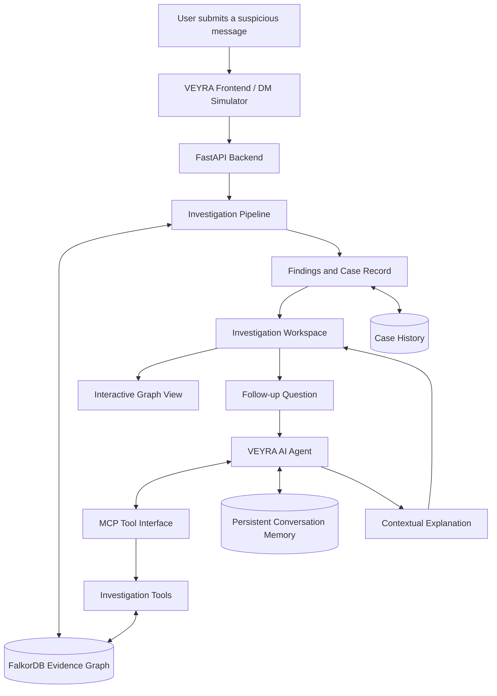
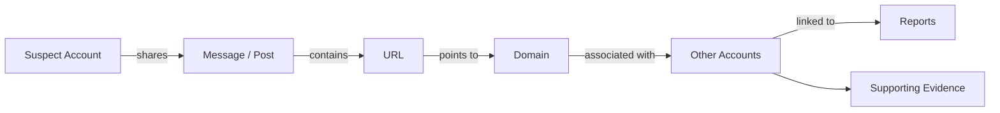
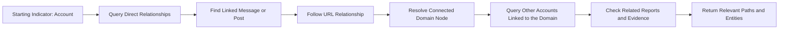
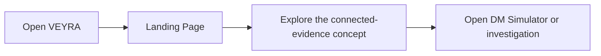
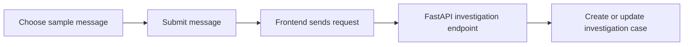
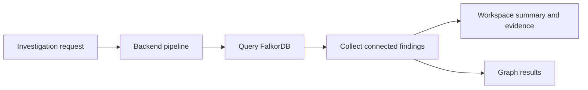
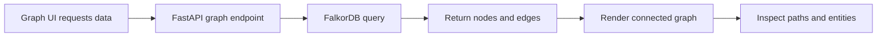
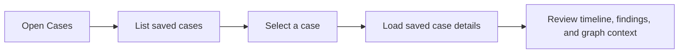
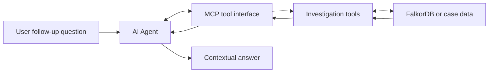
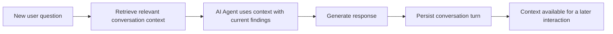

# VEYRA
### AI-Powered Connected Evidence Intelligence

**Investigate the message. Follow the connections. Understand the network.**

VEYRA is an AI-assisted cyber-investigation platform built to explore how suspicious digital activity may connect across accounts, messages, URLs, domains, brands, reports, payment identifiers, and supporting evidence. It combines graph intelligence, multi-hop traversal, an AI agent, MCP tools, investigation history, and persistent conversation context in one workflow.

## Why VEYRA?

Online scams rarely leave all their clues in one place. A suspicious message may contain a link, that link may lead to a domain, and that domain may be associated with other accounts or reports. Investigating each clue separately can make the wider picture difficult to see.

VEYRA was created to help connect those clues. It is inspired by real-world scam experiences and built as a demonstration of how graph databases and AI agents can support more connected, explainable investigations.

> VEYRA is a decision-support project. A shared connection or report is an investigative lead, not proof of wrongdoing. Findings should be verified before real-world action.

## The complete VEYRA workflow



### How the components work together

1. **Frontend:** accepts a suspicious message and presents investigation results.
2. **FastAPI backend:** receives requests and coordinates the investigation workflow.
3. **Investigation pipeline:** examines available indicators and requests relevant graph data.
4. **FalkorDB:** stores connected entities as nodes and their relationships as edges.
5. **Multi-hop traversal:** graph queries follow relationships from one entity to another to uncover further connections.
6. **MCP tools:** give the AI agent a structured interface to request investigation information.
7. **AI agent:** uses retrieved results and available context to answer follow-up questions.
8. **Case history and memory:** preserve investigation records and relevant conversational context for later sessions.

The main investigation pipeline can query FalkorDB directly. MCP is the tool interface for agent workflows; it does not itself perform graph traversal.

## What I injected into FalkorDB

VEYRA's demo graph uses structured synthetic investigation data. It represents entities that may appear in an online-scam investigation and connects them through explicit relationships.

| Graph entity | What it represents |
|---|---|
| `Account` | A platform-neutral social or online account |
| `Post` / message | Content shared by an account |
| `URL` | A link referenced in a message or post |
| `Domain` | The domain associated with a URL |
| `Brand` | A brand referenced in a scenario, including potential impersonation |
| `PaymentIdentifier` | A payment destination mentioned in the scenario |
| `Report` | A report record linked to relevant entities |
| `Evidence` | A supporting observation or indicator |
| `Scenario` | A synthetic case used to demonstrate an investigation |

Nodes represent entities. Edges represent relationships such as an account sharing a post, a post containing a URL, a URL resolving to a domain, or an account being associated with a report.

### Example: from one clue to a wider network



This is a conceptual example of the investigation path. The actual path depends on the relationships present in the graph.

### Why FalkorDB matters

**FalkorDB is the connected evidence layer at the heart of VEYRA.** Rather than storing every clue as an isolated record, it stores the relationships between entities so graph queries can retrieve connected paths.

When VEYRA investigates an account, traversal can follow its relationships to a message, then a URL, then a domain, and onward to other connected accounts or reports. Each hop extends the search through recorded relationships. The backend collects the relevant results, and the frontend visualizes the returned nodes and edges.

This makes the investigation explainable: users can inspect the connections behind a finding rather than seeing only a final label.

### How graph querying and multi-hop traversal work

A graph query starts from a known entity or indicator, matches its recorded relationships, and returns the connected nodes and edges. Multi-hop traversal extends that process across more than one relationship. The investigation logic controls which paths to follow and which results to return.



For example, the conceptual path may be `Account → Message → URL → Domain → Other Account → Report`. Each arrow is a relationship stored in the graph; the path only appears if the relevant nodes and edges exist in the data. The traversal code and graph queries perform this exploration, while the UI displays the returned results.

**Why can this be fast?** FalkorDB is designed for querying relationships in a graph, so the application can request connected paths directly instead of manually joining separate exported files in the frontend. The backend can also limit traversal depth and return only relevant fields or paths. Actual response time depends on graph size, query shape, data volume, server resources, and how many hops are requested. VEYRA does not claim a benchmark unless it is measured against a defined dataset and workload.

## Explore each VEYRA screen

### 1. Landing Page: A Network of Evidence

The landing page introduces VEYRA through a visual connected-network experience. It presents the central idea of the platform: digital clues can be related, and those relationships can help reveal a wider picture.



### 2. DM Simulator: Start with a Message

The DM Simulator presents sample messages from the demo scenarios. A user selects or submits a message to begin an investigation. The backend uses the available indicators and graph data to investigate relevant connections.



### 3. Investigation Workspace: Follow the Evidence

The workspace brings together the investigation summary, findings, supporting information, and graph results. Users can move from the initial indicator to connected entities and examine how the returned relationships form an investigative path.



### 4. Graph Explorer: See the Relationships

The graph view visualizes returned nodes and edges. It helps users explore connected accounts, URLs, domains, reports, and other entities. Multi-hop traversal is performed by the investigation logic and graph queries; the UI makes the resulting connections easier to inspect.



### 5. Cases & History: Revisit Earlier Work

The Cases page lists saved investigation records. Opening a case can show the available case details, status, recorded timeline, findings, and graph context. The information shown depends on what was saved for that investigation.



### 6. AI Agent Chat: Ask Follow-up Questions

The AI agent supports natural-language questions about available investigation information. It can use structured results from investigation tools, retrieved graph information, and relevant context to explain findings or help explore another angle.



MCP provides the tool interface; the investigation tools perform the requested operation. Not every graph query has to pass through MCP because the primary investigation pipeline can query FalkorDB directly.

### 7. Persistent Memory: Carry Context Forward

Conversation memory helps retrieve relevant context from earlier interactions and save new context when configured. It is separate from FalkorDB's evidence graph and the saved case record. Together, these layers help VEYRA continue an investigation without treating every interaction as an entirely new start.



## Why MCP and AI make VEYRA stronger

MCP provides a structured way for the AI agent to call investigation tools. Those tools can retrieve relevant graph or case information and return structured results. The AI agent then uses the returned information and available context to formulate a natural-language response.

The responsibilities stay distinct:

- **FalkorDB** stores connected evidence.
- **Graph queries and traversal logic** explore relationships.
- **MCP** exposes tools to the agent.
- **The AI agent** helps explain retrieved information.
- **Case history** preserves investigation records.
- **Persistent memory** helps recover relevant conversational context.

This combination makes VEYRA more than a static graph viewer. It brings together connected data, investigation workflows, and conversational exploration.

## Run Veyra Locally

```bash
git clone https://github.com/BAVYASAKTHIVEL-21/Veyra.git
cd Veyra
chmod +x start-veyra.sh
./start-veyra.sh
```

Once startup completes, open **http://localhost:8080** in your browser.

Veyra automatically starts the services and seeds the FalkorDB graph.

**✨ Play around with Veyra!** Explore different safe and suspicious scenarios, inspect connected accounts and graph relationships, and see how Veyra investigates potential threats. Have fun experimenting!

## See VEYRA in action

🎥 **Demo:** [VEYRA on YouTube](https://youtu.be/yANb3tzrCDY?si=P0RzDpl_sKf2jyiy)

💻 **Connect** [LinkedIn](www.linkedin.com/in/bavya21)

## Project status

VEYRA is a demonstration project built around synthetic investigation scenarios. Its goal is to show how graph relationships, multi-hop queries, AI-assisted exploration, case history, and persistent context can work together in a cyber-investigation workflow.

Detection quality depends on the available data and implemented analysis logic. A connection or report should never be treated as independent proof of malicious activity.

---

**VEYRA connects the evidence, follows the relationships, and helps uncover the network behind the threat.**
